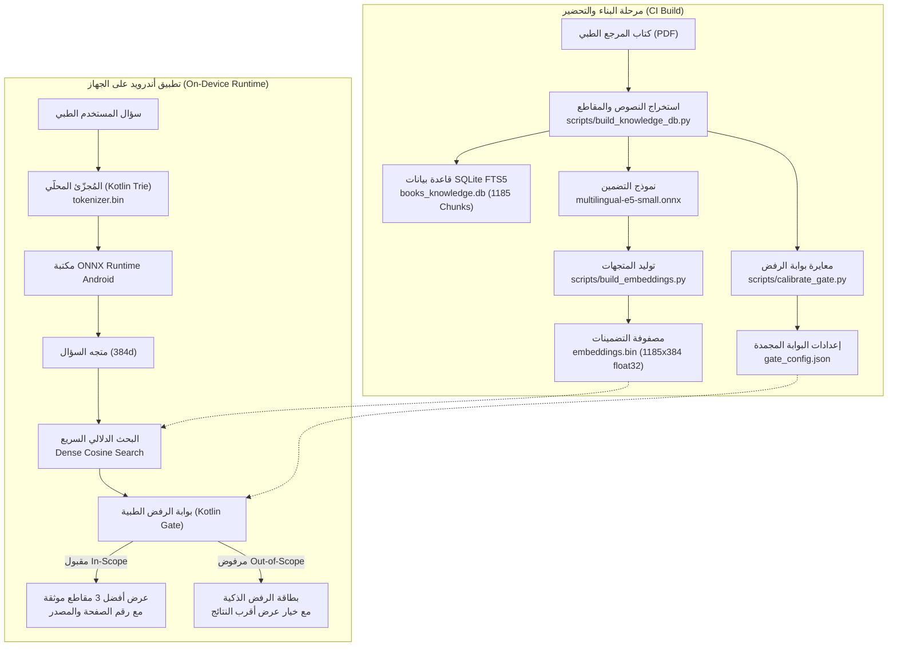

# المساعد الطبي المحلي / MedAI Offline Assistant

[](https://github.com/ffgg57594-gif/offline-local2/actions/workflows/build_apk.yml)
[](https://github.com/ffgg57594-gif/offline-local2/releases/latest)
[](LICENSE)
[-green.svg)](https://developer.android.com)
[-brightgreen.svg)]()

تطبيق أندرويد طبي يعمل بالكامل محلياً وبدون اتصال بالإنترنت (100% Offline)؛ يجيب عن الأسئلة الطبية في تخصص أمراض النساء والتوليد (Obstetrics & Gynaecology) **حصرياً** من كتاب المرجع الطبي المدمج أثناء البناء (`425_OBG_clean_single_pages.pdf`).

An offline-first, privacy-respecting Android application (Kotlin, Jetpack Compose, ONNX Runtime Mobile, SQLite FTS5) that answers clinical Obstetrics & Gynaecology questions **strictly** from one embedded medical textbook baked into the app at build time.

---

## المزايا الأساسية / Core Features

- **خصوصية مطلقة (Zero Internet Permission):** لا يحتوي ملف `AndroidManifest.xml` على إذن الإنترنت نهائياً. تجري كافة عمليات التجزئة (Tokenization)، وتوليد المتجهات (Embedding)، والبحث الدلالي (Dense Search)، وقرارات بوابة الرفض (Refusal Gate) محلياً على عتاد الجهاز.
- **نظام تصميم "ورق وحبر" (Paper & Ink Design System):** مستوحى من الكتب والمراجع الطبية العريقة:
  - ألوان متناسقة: تركواز داكن (`#0F5C5C`)، تيراكوتا للرفض والتحذير (`#BA3D2A`)، ورق دافئ (`#F7F4EE`)، وفحم داكن (`#1B1D1E`).
  - خطوط مفتوحة المصدر (OFL): خط **Source Serif 4** للمقاطع الطبية، وخط **IBM Plex Sans Arabic** لواجهات التحكم.
  - مطابقة تامة لمعايير التباين **WCAG AA** لجميع أزواج الألوان الـ 36 في الوضعين الفاتح والداكن.
  - عزل نصوص المصادر ثنائية الاتجاه (Explicit Bidi Isolation) بأحرف `\u2068` و `\u2069` لمنع تداخل أرقام الصفحات مع العناوين الإنجليزية.
- **محرك بحث متطابق ومُعاير (Calibrated On-Device AI Engine):**
  - نموذج تضمين مضغوط: `multilingual-e5-small` (ONNX Quantized) بحجم متجهات 384 بعداً.
  - بوابة رفض طبية مُعايرة بنمطين: **متوازن (Balanced)** و **صارم (Strict)** ترفض بدقة الأسئلة الخارجة عن النطاق (مثل الاستفسارات العامة أو التخصصات الطبية الأخرى).
  - مطابقة 120/120 سؤالاً بالنمط المتوازن و 119/120 بالنمط الصارم مقارنة بمرجع بايثون على المحاكي.
- **سرعة استجابة فائقة:** زمن بحث إجمالي يبلغ **72 مللي ثانية** فقط (p50) على محاكي أندرويد.
- **اختبارات آلية شاملة في CI:** 69 اختبار أجهزة على محاكي API 34، و14 لقطة شاشة موثقة ومعتمدة تلقائياً.

---

## بنية النظام ومسار المعالجة / Pipeline Architecture



---

## نظام التصميم: "ورق وحبر" / Paper & Ink Design System

تم اعتماد نظام التصميم **الاتجاه أ: "ورق وحبر"** ليعكس هوية المراجع الطبية المطبوعة مع مراعاة راحة العين في القراءة الطويلة:

### 1. لوحة الألوان المعتمدة (WCAG AA Certified)

| الفئة / العنصر | الوضع الفاتح (Light) | الوضع الداكن (Dark) | نسبة التباين الفاتح | نسبة التباين الداكن |
|---|:---:|:---:|:---:|:---:|
| **الخلفية (Background)** | `#F7F4EE` (ورق دافئ) | `#1B1D1E` (فحم دافئ) | — | — |
| **النص الأساسي (Body Ink)** | `#1B2024` (حبر داكن) | `#F3EFE7` (ورق فاتح) | **14.96:1** | **14.75:1** |
| **النص الثانوي (Secondary Text)** | `#424D53` | `#B8B3A7` | **7.91:1** | **8.09:1** |
| **بطاقة النتائج (Surface)** | `#EFECE4` | `#2B2E2F` | **13.91:1** | **11.93:1** |
| **اللون الأساسي (Primary Teal)** | `#0F5C5C` (تركواز ديب) | `#62B8B8` (تركواز مشرق) | **7.76:1** | **5.66:1** |
| **تنبيه الرفض (Terracotta Alert)** | `#BA3D2A` | `#FFB4A9` | **5.54:1** | **7.71:1** |
| **قلم التحديد (Amber Highlight)** | `#F8E4B3` (كهرماني) | `#4E3E18` (كهرماني داكن) | **13.09:1** | **8.61:1** |
| **تبويب علامة الصفحة (Bookmark Tab)** | `#DDEBE9` | `#194545` | **8.07:1** | **8.02:1** |

### 2. الطباعة والخطوط (Typography)
- **المقاطع الطبية:** خط **Source Serif 4** يمنح المقاطع الطبية والفقاعات مظهراً يشبه كتب ومجلات أكسفورد الطبية.
- **واجهة المستخدم والأزرار:** خط **IBM Plex Sans Arabic** يوفر وضوحاً هندسياً مريحاً للقراءة باللغتين العربية والإنجليزية.

---

## لقطات الشاشة الـ 14 الرسمية / Official UI Screenshots

تتضمن حزمة الفحص الآلي `ui-screenshots-v2` (بحجم إجمالي 11.35 ميجابايت) 14 حالة معتمدة ومحققة برمز SHA-256 فريد لكل صورة:

| الرقم | الملف | الوصف | SHA-256 Hash |
|---|---|---|---|
| 01 | `01_empty_light.png` | الحالة الفارغة (فاتح): رسم المتجه لكتاب وعدسة، سطر المرجع المدمج، 4 بطاقات أسئلة استرشادية | `8f87ab2d613506d488d918d3788587d0be10edae42bb01d7ec32723f276dfb90` |
| 02 | `02_empty_dark.png` | الحالة الفارغة (داكن): على خلفية الفحم الدافئ المتناسقة | `a7c5b94f10100ce2f9f86d8448cf8e308a015010aecc8566e08676c0d4566f69` |
| 03 | `03_results_light_keyboard_closed.png` | عرض النتائج (فاتح): البطاقات الـ 3 مع شريط الهامش الرأسي، وتبويب "ص 261" | `a7a23d892d7aea2ce1808c2a78a216e47e6b67b46c05052430ea9356941a4d91` |
| 04 | `04_results_dark_keyboard_closed.png` | عرض النتائج (داكن): إبرازات قلم التمييز الكهرماني الداكن | `e0335a1ce07ce4c8932bdc532141d2450cc852db5f91104e5ab8fe6ba15982c2` |
| 05 | `05_results_font13_dark.png` | عرض النتائج عند تكبير الخط 1.3x (داكن): ثبات تام وتناسق الأسطر دون اقتطاع | `c0ea9375f0fb3880a0da4e48a6860f9bf26d3b8d9a3d31dd2786b7c71a5f610e` |
| 06 | `06_sheet_top_light.png` | قمة ورقة المقطع الكامل (فاتح): الترويسة المثبتة ومؤشر "فقرة X من Y في الكتاب" | `a40d8f1452e91c840ae6032f25679966157213633a125d7d55141416a5747d79` |
| 07 | `07_sheet_bottom_light.png` | أسفل ورقة المقطع (فاتح): أزرار التنقل (السابق، التالي، نسخ النص) | `da8b39f5278f9d7087022a1bb1832209e2453037aaade13a19915e35d9908363` |
| 08 | `08_sheet_top_font13_light.png` | قمة ورقة المقطع عند خط 1.3x (فاتح): قراءة مريحة مع ثبات الترويسة | `359940ebf0be5116d3798ac8c4cf79342613f7419b7540af492dff84bff7886c` |
| 09 | `09_sheet_bottom_font13_light.png` | أسفل ورقة المقطع عند خط 1.3x (فاتح): أزرار مرتفعة بهوامش لمس $\ge 48\text{dp}$ | `897c3935a07d32ec1253ab6b05dadb593b714eb78cd30b16ae2dcd413c9e8685` |
| 10 | `10_refusal_collapsed_light.png` | بطاقة الرفض (فاتح): أيقونة التيراكوتا التحذيرية وزر "عرض أقرب النتائج" | `7697eb086339189b414c488ed1603f41bbe663682671d258e364093b980b703d` |
| 11 | `11_refusal_expanded_light.png` | بطاقة الرفض الموسعة: عرض أقرب النتائج بعد النقر على الزر | `c5b39f1fd46b2580b127a5632f2cac9575704fb5a2080e969529eeafdc8d8a8f` |
| 12 | `12_loading_searching_light.png` | بطاقة البحث الجاري (فاتح): مؤشر البحث الدائري وزر الإلغاء | `b963d7d0f0382e567733454ae511b683f7d57cd212df33e1723fbb738c7e1d9a` |
| 13 | `13_settings_strict_light.png` | لوحة الإعدادات: اختيار النمط الصارم Strict ومفاتيح التحكم بالتشخيصات | `7ea107b5c0ac285649a3d817398117ecb9e093b91b0dd05032d8daac1cce51cc` |
| 14 | `14_long_english_passage_light.png` | مقطع إنجليزي طويل: الحفاظ على اتجاه LTR داخل غلاف واجهة RTL العربية | `276bbdd2e7ff4713910405a9dab64fdadf2ea4fd92f2d33a0adf44fd8916a0b0` |

---

## قياسات الأداء المعتمدة على المحاكي (Benchmark & Latency)

تم قياس الأزمنة الفعلية لكل مرحلة عبر الاختبار الآلي `K5bBenchmarkUiTest` على محاكي API 34 (30 تكرار لكل مرحلة):

| المرحلة (Stage) | الوسيط p50 (ms) | الشريحة p95 (ms) | الحد الأقصى Max (ms) |
|---|:---:|:---:|:---:|
| **التجزئة (Tokenize)** | **0** | 5 | 8 |
| **التضمين (Embed Query)** | **55** | 79 | 155 |
| **البحث في المتجهات (Dense Search)** | **7** | 17 | 24 |
| **حساب إشارات البوابة (Gate Signals)** | **5** | 29 | 33 |
| **قرار البوابة (Gate Decision)** | **0** | 0 | 3 |
| **زمن المعالجة الكلي (Total Pipeline)** | **72** | **90** | **175** |
| **التشغيل البارد لأول مرة (Cold Start)** | — | — | 128,749 (التهيئة الأولى واستخراج الأصول) |
| **تحميل نموذج ONNX في الذاكرة (Model Load)** | — | — | **268** |

---

## البناء والتطوير / How to Build and Run

### 1. البناء التلقائي عبر GitHub Actions (الطريقة الموصى بها)
نظراً لأن تطوير التطبيق يُدار بالكامل عبر بيئة هاتفية خفيفة، يتم بناء وتوقيع حزم APK واختبارها عبر خط أنابيب GitHub Actions:
1. ضع ملف المرجع الطبي `*.pdf` في مجلد `app/src/main/assets/books/`.
2. ادخل إلى تبويب **Actions** في مستودع GitHub واختر **Build APK** ثم انقر **Run workflow**.
3. يقوم الـ CI باستخراج النصوص وتوليد التضمينات وتشغيل 69 اختباراً على محاكي أندرويد ثم بناء وتوقيع حزمة `app-release-unsigned.apk`.
4. نزّل الحزمة من صفحة [Releases](https://github.com/ffgg57594-gif/offline-local2/releases).

### 2. البناء المحلي (Local Debug Build)
داخل بيئة PocketDev أو بيئة Linux المحلية:
```bash
# بناء حزمة الـ Debug السريعة (بدون تشغيل Gradle daemon):
gradle -Dorg.gradle.jvmargs= --no-daemon --max-workers=2 \
  --init-script /root/.gradle/init.d/pocketdev-android.gradle \
  -Pandroid.aapt2FromMavenOverride=/root/android-sdk/build-tools/35.0.0/aapt2 \
  assembleDebug --console=plain
```

### 3. تدقيق التباين ومعرض التصميم محلياً
```bash
# فحص مطابقة التباين WCAG AA لكافة الأزواج:
python3 scripts/check_contrast.py

# التحقق من خلو حزمة الإصدار من كود المعرض التجريبي:
python3 scripts/verify_release_no_gallery.py app/build/outputs/apk/release/app-release.apk
```

---

## هيكل المستودع / Project Structure

```
├── app/
│   ├── src/
│   │   ├── main/
│   │   │   ├── java/com/medai/assistant/
│   │   │   │   ├── MainActivity.kt        # النشاط الرئيسي والثيم العام
│   │   │   │   ├── ask/                   # آلة الحالات (AskStateMachine) ومنطق البحث
│   │   │   │   ├── design/                # نظام التصميم (Tokens, Typography, Spacing, Themes)
│   │   │   │   │   ├── components/        # المكونات الأساسية (Cards, InputBar, TopBar, EmptyState)
│   │   │   │   │   └── motion/            # حركات الدخول التدريجي المهدأة (Reduced Motion)
│   │   │   │   ├── repository/            # مستودع النصوص وقاعدة بيانات SQLite FTS5
│   │   │   │   └── ui/                    # الشاشات الحقيقية (AskScreen, SettingsSheet)
│   │   │   ├── assets/                    # أصول المعرفة (مستخرجة أثناء البناء)
│   │   │   │   ├── books/                 # مجلد ملفات الـ PDF الأصلية (لا تُشحن في الـ APK)
│   │   │   │   └── fonts/                 # خطوط OFL (Source Serif 4, IBM Plex Sans Arabic)
│   │   ├── debug/                         # معرض التصميم التجريبي (DesignGallery) معزول تماماً
│   │   └── androidTest/                   # 69 اختبار أجهزة على المحاكي (K4d, K5b, K5c)
├── eval/                                  # أسئلة التقييم الذهبية (Golden 120 questions) وإشارات البوابة
├── scripts/                               # سكريبتات البايثون لبناء الأصول وتدقيق التباين وفحص الجودة
└── .github/workflows/build_apk.yml        # مسار التكامل المستمر الشامل (Build, Test, Release)
```

---

## ترخيص المشروع / License

هذا المشروع مرخص تحت رخصة **MIT**. الخطوط المدمجة (`Source Serif 4`, `IBM Plex Sans Arabic`) تخضع لرخصة الخطوط المفتوحة **SIL Open Font License (OFL)**.
